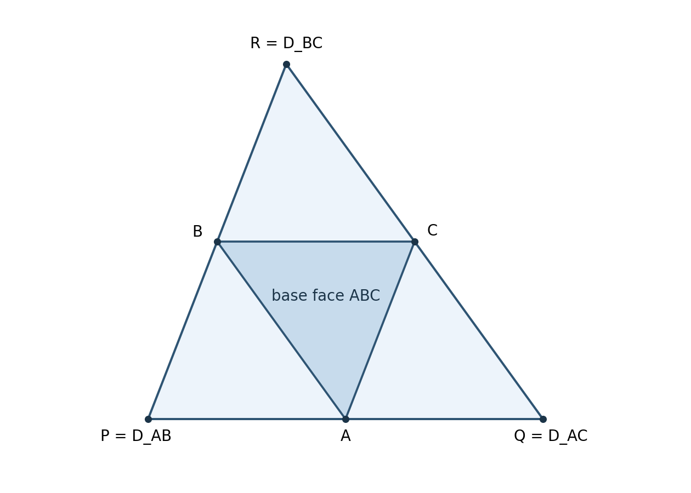

# Rank rigidity and the remaining conicity problem for four equal Gaussian cells

mxym/math research project — AI-assisted mathematical research, 8 October 2026

## Abstract

For the maximum of the sum of squared Gaussian first moments over four
measurable cells of mass $1/4$ in dimension at least three, we prove that
every maximizing partition has moment rank exactly three. A second
variation in an unused Gaussian coordinate bounds the facet-weight
Laplacian by the identity. Its combination with Gaussian flux excludes
planar configurations in convex position. For a moment inside the other
three moments' convex hull, Gaussian isoperimetry and the elementary
three-cell propeller bound give a strict contradiction. We also prove
that a maximizing partition which is conical at the origin must be the
regular tetrahedral partition, and that the regular partition is locally
isolated among all full-rank equal-mass stationary partitions, modulo
rotations. These are necessary-condition and conditional-classification
theorems, not a resolution of the global equal-mass conjecture. The
remaining obstruction is a full-rank, noncentral, irregular tetrahedral
partition. No priority or external human-review assertion is made.

## 1. Setting and exact conclusions

Let $\gamma_d$ be standard Gaussian measure, with density
$\varphi_d(x)=(2\pi)^{-d/2}e^{-|x|^2/2}$. For a measurable partition
$\mathcal C=(C_1,C_2,C_3,C_4)$ of $\mathbb R^d$, put

\[
 m_i=\int_{C_i}x\,d\gamma_d(x),\qquad
 F(\mathcal C)=\sum_{i=1}^4|m_i|^2,\qquad
 \gamma_d(C_i)=1/4.                                      \tag{1}
\]

Partitions and boundaries are understood up to Gaussian null sets.
The word moment always means the unnormalized vector $m_i$, not the
conditional mean $4m_i$. The moment rank is the dimension of their
linear span. Since $\sum_i m_i=0$, the rank is at most three.

**Theorem 1 (rank rigidity).** The maximum in (1) is attained. If
$d\ge3$, every maximizing partition has moment rank three. After an
orthogonal change of coordinates, its cells are the products with
$\mathbb R^{d-3}$ of a translated simplicial normal fan in $\mathbb R^3$:

\[
 C_i=\{x:m_i\cdot(x-w)\ge m_j\cdot(x-w)\text{ for all }j\}.\tag{2}
\]

Here the four $m_i$ are affinely independent, and $w$ is a unique apex
in their span. In particular, the theorem excludes every planar
Laguerre diagram, including the case of a bounded central cell.

**Theorem 2 (central classification).** If a maximizing partition in
Theorem 1 is conical at the origin, it is the regular tetrahedral
partition, up to rotation and relabeling. Its value is

\[
 F_{\rm tet}=\frac{12\theta^2}{\pi^3},\qquad
 \theta=\arctan\sqrt2.                                  \tag{3}
\]

In particular, proving Heilman's 2014 Conjecture 3 (origin conicity
of all four-cell equal-mass maximizers) would prove the regular
tetrahedral classification. Conversely, that classification implies
Conjecture 3. The two assertions are therefore equivalent in this case.

**Theorem 3 (local stationary uniqueness).** In the space of centered
full-rank moment lists and apices, there is a neighborhood of the
regular tetrahedral solution in which every equal-mass stationary
solution of (2) is a rotation of that solution. A stationary solution
here means that the vectors inducing the cells are exactly the cells'
Gaussian first moments. The assertion is local, without an explicit
neighborhood radius or a global exclusion.

Moreover the regular root is a strict local maximum of the balanced
score objective after removing rotations. Consequently, for all
measurable partitions whose normalized moment lists are sufficiently
close to a rotated regular list, $F\le F_{\rm tet}$, with equality
only for the regular partition. This local statement gives no
specified size for the neighborhood.

For clarity about sources: Heilman [H14, Conjecture 3, pp.36–37] says
*simplicial conical*, not *regular simplicial conical*. His Definition
1.7 distinguishes the two. The arbitrary-mass claim [H19, Conjecture
1.16] has a counterexample in the companion note [EX]; it does not
settle (1). The unit-variance Gaussian maximum comparison [M26] has
no general cell prices and is not used in these proofs.

## 2. Attainment, prices, and Gaussian flux

We include the structural argument to specify the class covered by
the subsequent variation. Let $p_i>0$ sum to one. Relax a partition
to functions $0\le f_i\le1$, $\sum_i f_i=1$, $\int f_i\,d\gamma=p_i$.
This is a weakly compact convex subset of $L^2(\gamma)^4$. Its moment
maps are weakly continuous because every coordinate of $x$ is in
$L^2(\gamma)$. The moment objective therefore attains its maximum
on the relaxed set. If $m_i$ are the moments of a relaxed maximizer,
every feasible $f$ has $\sum_i m_i\cdot\int xf_i\le\sum_i|m_i|^2$:
otherwise expanding the squared moments gives a strictly larger value.
Consequently the maximizers of this linear functional form an exposed
face. Every member of the face also maximizes the squared objective,
by Cauchy–Schwarz and the definition of the maximum. The face has an
extreme point by the Krein–Milman theorem, which is also extreme in
the relaxed set. Its functions are indicators: if two functions are
bounded away from both zero and one on a set of positive measure,
nonatomicity gives two equal-measure subsets there; adding a small
opposite signed transfer on these subsets produces two distinct
feasible functions whose average is the original. There are finitely
many pairs, so any nonindicator tuple admits such a transfer.
This proves attainment by a measurable partition.

At any maximizing partition the $m_i$ are distinct. Indeed equal
moments in two positive-measure cells allow an equal-mass exchange
of small sets near distinct density points. Their integral difference
$\Delta\ne0$ increases the objective by $2|\Delta|^2$.

For distinct scores $v_i$, define

\[
 \Psi(v,\lambda)=\sum_i p_i\lambda_i+
    \mathbb E\max_i(v_i\cdot G-\lambda_i),\qquad
 C(v)=\min_\lambda\Psi(v,\lambda).                        \tag{4}
\]

Fix $\min_i\lambda_i=0$. Then
$\Psi\ge p_{\min}\max_i\lambda_i$, so a minimum exists.
Affine-score ties have Gaussian measure zero, and differentiating
under the integral gives $\partial_{\lambda_i}\Psi=p_i-\gamma(C_i)$.
Thus its minimizing prices give precisely the prescribed masses.
The corresponding Laguerre cells maximize the linear assignment
$\sum_i v_i\cdot\int_{C_i}x$. Every global squared-objective
maximizer also maximizes this linear assignment with $v_i=m_i$,
by the expansion just used. Equality in the pointwise maximum then
identifies its cells as these Laguerre cells. All inequalities depend
only on the span of the moments; the other Gaussian coordinates
factor out. This proves the cylindrical assertion before the rank
is identified.

Write $\Sigma_{ij}$ for the relatively open $ij$ facet, excluding
multiple ties, and set zero for an absent facet. In the effective
space of rank $r$, define

\[
 A_{ij}=\int_{\Sigma_{ij}}\varphi_r\,d\mathcal H^{r-1},\quad
 w_{ij}=\frac{A_{ij}}{|m_i-m_j|},\quad
 (Lu)_i=\sum_{j\ne i}w_{ij}(u_i-u_j).                     \tag{5}
\]

The symbol $w_{ij}$ denotes an edge weight; the bold geometric apex
in (2) is the vector $w$. Formula (5) applies also to cylindrical
facets because the extra Gaussian coordinates integrate to one.
Gaussian integration by parts gives

\[
 m_i=\sum_{j\ne i}w_{ij}(m_i-m_j),\qquad LM=M,             \tag{6}
\]

where $M$ is the matrix whose rows are $m_i$. For justification on
unbounded cells, intersect with balls of radius $R$: the artificial
Gaussian boundary flux is $O(R^{r-1}e^{-R^2/2})$, tending to zero.
The inward $ij$ normal is $(m_i-m_j)/|m_i-m_j|$.

## 3. The unused-coordinate second variation

**Lemma 4 (spectral constraint).** If a maximizing partition has an
unused Gaussian coordinate, its matrix (5) satisfies

\[
 L\preceq I\text{ on }\mathbf1^\perp,\qquad
 W:=P-L\succeq0,\qquad P=I-\mathbf1\mathbf1^T/4.           \tag{7}
\]

*Proof.* Let $X$ be the effective Gaussian vector and $Z$ an independent
standard normal in an unused direction $e$. Perturb scores to
$v_i(t)=m_i+t a_i e$. The balanced linear assignment value is $C(v(t))$.
For every $v$, completing squares cell by cell proves

\[
 H(v):=2C(v)-\sum_i|v_i|^2\le\max F,
       \qquad H(m)=F.                                   \tag{8}
\]

At fixed prices, the first variation in $t$ vanishes by $\mathbb EZ=0$.
The second variation of the expected maximum is

\[
 \partial_{tt}\Psi(v(t),\lambda)|_{t=0}
   =\sum_{i<j}\frac{1}{|m_i-m_j|}
        \int_{\Sigma_{ij}}(a_i-a_j)^2\mathbb EZ^2
                     \varphi_r\,d\mathcal H^{r-1}
   =a^TLa.                                               \tag{9}
\]

There is no extra factor two in (9). Locally across one facet, if
$s$ is its signed normal distance, the difference of the two scores
is $|m_i-m_j|s$. Integrating the change in the maximum after shifting
this difference by $t(a_i-a_j)Z$ gives
$t^2(a_i-a_j)^2Z^2/(2|m_i-m_j|)$ times the surface density to
second order. The second derivative is (9).

We spell out why optimizing the prices does not change (9). The
price Hessian at zero is $L$, obtained by the same facet calculation.
Its kernel is precisely the common-price direction. The facet
adjacency graph is connected: a generic segment between interiors
of any two positive cells crosses only ordinary facets. Hence $L$
is positive definite on $\mathbf1^\perp$. The mixed derivatives
$\partial_t\partial_\lambda\Psi$ vanish because the first-order
flux is proportional to $\mathbb EZ$. The implicit function theorem
for the mass equations therefore gives $\lambda'(0)=0$ on the
common-price gauge slice. Along these minimizing prices, (9) remains
the second derivative of $C$.

The differentiability used here holds also when four planar cells
meet at one point. Indeed no triple tie can have codimension one
when all cells have positive mass: in that event three slopes are
affinely collinear with matching prices, and the middle score is a
convex combination of the other two everywhere, so its cell has
zero mass. All multiple ties thus have codimension at least two.
On compact sets, a tube of thickness $O(t)$ around these ties has
volume $O(t^2)$, while a score perturbation is $O(t)$, so it changes
the expected maximum only by $O(t^3)$. Away from the tubes the
two-score facet calculation applies. Gaussian tails make the same
estimates integrable for the linear factors $1+|X|+|Z|$; one may
first restrict these factors, apply the compact calculation, then
let the restriction tend to infinity. This proves the $C^2$ expected
maximum formula and the $C^1$ mass map used in the implicit function
argument.

At the maximum, (8) has nonpositive second derivative. Its value is
$2(a^TLa-|a|^2)$, so $L\preceq I$. Since $L\mathbf1=0$, this is
equivalent to $P-L\succeq0$. $\square$

## 4. A self-contained three-cell bound and a strict profile estimate

Put $B=9/(8\pi)$. We use the classical three-cell bound

\[
 \sum_{i=1}^3\left|\int_{D_i}x\,d\gamma_d\right|^2\le B  \tag{10}
\]

without mass restrictions. Here is a short proof. If its moments
$b_i$ have squared sum $S>0$, their centered scores
$v_i=b_i/\sqrt S$ span at most two dimensions and have squared
norm sum one. Pointwise maximization gives
$\sqrt S\le\mathbb E\max_i v_i\cdot G$. The maximizing score cells
are at most three planar sectors, possibly with empty cells. For
a sector of angle $\alpha$, its moment is
$\sin(\alpha/2)/\sqrt{2\pi}$ times its bisector. Thus the sector
partition has squared moment sum
$\sum_i\sin^2(\alpha_i/2)/(2\pi)$.
If $x_i=\alpha_i/2$ sum to $\pi$, the identity
$\sum\sin^2x_i=2+2\prod\cos x_i$ bounds this by $9/(8\pi)$:
a negative cosine makes the product nonpositive, and otherwise
concavity of $\log\cos$ bounds the product by $1/8$ (endpoints by
continuity). Cauchy–Schwarz on the score-cell moments now gives
$\mathbb E\max_i v_i\cdot G\le\sqrt B$, proving (10).
Rank-one scores are handled by the same sectors after adjoining an
unused coordinate. This proof is a restatement of the classical
propeller calculation [KN09], not a novelty assertion.

Let $q=\Phi^{-1}(3/4)$ and $h_0=\phi(q)$, where
$\phi(t)=(2\pi)^{-1/2}e^{-t^2/2}$ and $\Phi$ is its distribution
function. We need the strict elementary estimate

\[
 h_0^2>\frac{9}{32\pi}=\frac B4.                          \tag{11}
\]

Indeed $\pi<22/7<32/9$ gives $\phi(0)>3/8$, and
$e^{-x^2/2}\ge1-x^2/2$ yields
$\Phi(3/4)>1/2+(3/8)(87/128)>3/4$. Thus $0<q<3/4$.
Taylor's theorem gives
$e^{-u}\ge1-u+u^2/2-u^3/6$ for $u\ge0$. This last polynomial is
strictly decreasing, so
$e^{-q^2}>4637/8192>9/16$, proving (11).

The other input is the classical Gaussian isoperimetric theorem:
a polyhedral cell of mass $p$ has total Gaussian perimeter at least
$\phi(\Phi^{-1}(p))$. We use it only for a single cell of mass $1/4$.
This standard theorem is an imported analytic dependency, not
formalized or reproved here; see [B75, ST78] and [H19, §1].

## 5. Complete exclusion of moment rank two

Suppose a maximizer has rank two. Since $d\ge3$, Lemma 4 applies.
The kernel of $W$ contains the three-dimensional span of
$\mathbf1$ and the two columns of $M$. Therefore

\[
 W=c aa^T,\qquad c\ge0,\quad
 a\perp\mathbf1,\quad a^TM=0.                           \tag{12}
\]

The nonzero vector $a$ spans this one-dimensional orthogonal
complement. Comparing off-diagonal entries gives

\[
 w_{ij}=1/4+c a_i a_j.                                  \tag{13}
\]

**Case A: all four moments are vertices of their convex hull.**
They form a convex quadrilateral. Its unique affine dependence
has, after labeling, $a_1,a_3>0$ and $a_2,a_4<0$.
Write $s_i(x)=m_i\cdot x-\lambda_i$.
The number $K=\sum_i a_i s_i(x)=-\sum_i a_i\lambda_i$
is independent of $x$. On an ordinary $13$ facet,
$s_1=s_3=T>s_2,s_4$ implies
$K=a_2(s_2-T)+a_4(s_4-T)>0$.
On a $24$ facet the same argument gives $K<0$.
Both diagonal facets consequently cannot be present. But (13)
gives $w_{13},w_{24}\ge1/4$, a contradiction.

**Case B: a moment lies in the convex hull of the other three.**
Relabel it as $m_4=\sum_{j=1}^3\alpha_jm_j$, with
$\alpha_j\ge0$ and $\sum\alpha_j=1$. In (12) use
$a=(\alpha_1,\alpha_2,\alpha_3,-1)$. Formula (13) gives
$w_{4j}\le1/4$, also when an $\alpha_j$ vanishes. Put
$t=|m_4|$ and $F=\sum|m_i|^2$.
The perimeter of the fourth cell satisfies

\[
 h_0\le\sum_j A_{4j}
    \le\frac14\sum_{j=1}^3|m_4-m_j|
    \le\frac{\sqrt3}{4}\sqrt{F+4t^2}.                    \tag{14}
\]

The last identity before Cauchy–Schwarz is
$\sum_j|m_4-m_j|^2=F+4t^2$, using $\sum_i m_i=0$.

If $t>0$, some $j$ has $m_4\cdot m_j\ge t^2$ by the convex
combination. Merging those two cells and using (10) gives
$F+2t^2\le B$. Project onto $m_4/t$: one projection equals $t$,
another $s\ge t$, and the other two sum to $-t-s$.
Hence
$F\ge t^2+s^2+(t+s)^2/2\ge4t^2$.
If $t=0$, the same two inequalities follow by merging any cell
with cell four. In either case $t^2\le B/6$ and therefore

\[
 F+4t^2\le B+2t^2\le4B/3.                               \tag{15}
\]

Equations (14)–(15) imply $h_0\le\sqrt B/2$, contradicting
(11). This includes a moment on an edge of the hull, not only a
strictly interior moment. Cases A and B exhaust four distinct
rank-two points. Thus rank two is impossible.

## 6. Rank one, and completion of Theorem 1

If the moment rank is one, distinct slopes give four ordered
intervals in that coordinate. Their masses force endpoints
$-q,0,q$. Their moments, in increasing order, are
$-\phi(q),\phi(q)-\phi(0),\phi(0)-\phi(q),\phi(q)$.
Since $0<\phi(q)<\phi(0)$, their squared sum is strictly below
$2\phi(0)^2=1/\pi$. The partition into four coordinate quadrants
in a plane has equal masses and value $1/\pi$, so the rank-one
partition cannot maximize. Rank zero contradicts distinct moments.
This completes the rank conclusion. Rank three and $\sum_i m_i=0$
make the four points affinely independent. The differences of
three prices consequently determine the unique apex $w$ in (2).

An additional useful consequence of (6), requiring no unused
coordinate, is

\[
 L=P,\qquad w_{ij}=1/4\quad(i\ne j)                      \tag{16}
\]

at every full-rank stationary solution. Indeed the columns of $M$
span $\mathbf1^\perp$, on which $L$ is the identity by (6).
Conversely (16) and the flux formula make the inducing vectors
exactly the cell moments. Thus the six weight equations are exact
stationarity equations, not merely necessary scalar inequalities.

## 7. Central cones: disphenoid geometry and regularity

If a full-rank maximizing partition is conical at the origin,
each of its affine facets must contain the origin. All six facets
of a full-rank four-score normal fan are present; hence all prices
are equal and its apex is zero.

The normal cone at each vertex of the score tetrahedron
$T=\operatorname{conv}(m_1,m_2,m_3,m_4)$ has spherical area $\pi$,
because its Gaussian mass is $1/4$. By the spherical triangle
area formula, this normal-cone area is $2\pi$ minus the sum of the
three planar face angles at that vertex. Thus the sum of face
angles at every vertex of $T$ is $\pi$.

**Lemma 5 (elementary unfolding).** A nondegenerate tetrahedron with
face-angle sum $\pi$ at every vertex has equal opposite edges.

*Proof.* Choose face $ABC$, and unfold the three adjacent faces
containing the remaining vertex $D$ outward into the plane of
$ABC$. Let $P,Q,R$ be the respective images of $D$ from faces
$ABD,ACD,BCD$. At $A$ the consecutive angles from $AP$ to $AB$,
from $AB$ to $AC$, and from $AC$ to $AQ$ sum to $\pi$.
Thus $P,A,Q$ are collinear with $A$ between $P,Q$; the equal
lengths $AP=AQ=AD$ make $A$ their midpoint. Likewise $B$ is
the midpoint of $PR$, and $C$ of $QR$. The midpoint theorem
therefore gives $AD=BC$, $BD=AC$, and $CD=AB$. $\square$

{width=75%}

Such a tetrahedron is a disphenoid. Its centered vertices can be
written, in orthogonal coordinates,

\[
 (a,b,c),\ (a,-b,-c),\ (-a,b,-c),\ (-a,-b,c),\qquad a,b,c>0.\tag{17}
\]

For completeness, the three vectors $(m_1+m_2)/2$,
$(m_1+m_3)/2$, $(m_1+m_4)/2$ give this representation; equality
of opposite edges makes them pairwise orthogonal. Rank three
makes each nonzero. Their signs can be absorbed into the axes.

On the $12$ facet, set $s_x=\sqrt{b^2+c^2}$ and use orthonormal
coordinates $X=x$, $Y=(cy-bz)/s_x$. The remaining inequalities
are $X\ge bc|Y|/(a s_x)$. Consequently

\[
 A_{12}=\frac{\phi(0)}{\pi}
       \arctan\frac{a s_x}{bc},\quad
 w_{12}=\frac{\phi(0)}{2\pi}
       \frac{\arctan(a s_x/(bc))}{s_x}.                   \tag{18}
\]

The $13$ formula exchanges $a,b$, with
$s_y=\sqrt{a^2+c^2}$. If $a>b$, then $s_x<s_y$ and
$a s_x/(bc)>b s_y/(ac)$, since the difference of the squared
cross-multiplied quantities is

\[
 (a^2s_x)^2-(b^2s_y)^2
 =(a^2-b^2)\{a^2b^2+c^2(a^2+b^2)\}>0.                  \tag{19}
\]

Strict monotonicity and positivity of arctangent give
$w_{12}>w_{13}$, contradicting (16). Interchanging axes proves
$a=b=c$. Formula (18) and (16) now force
$a=\theta/\pi^{3/2}$ and $F=12a^2$, proving Theorem 2.
No theorem comparing general Gaussian maxima is needed.

## 8. Local isolation in all nine parameters

Use the regular solution $m_i^0=a\sigma_i$, where the four
$\sigma_i$ are the sign vectors in (17), $a=\theta/\pi^{3/2}$.
Every centered full-rank list sufficiently close to it is obtained
by a linear map. Polar decomposition removes rotations, leaving
a positive symmetric map $I+B$, where

\[
 B=\begin{pmatrix}u&b_z&b_y\\b_z&v&b_x\\b_y&b_x&s\end{pmatrix}.
\]

The apex perturbation is $z=(z_x,z_y,z_z)$. Thus there are nine
parameters. The equations are the three independent equal-mass
equations and the six equations $w_{ij}=1/4$.
Their coefficients are smooth near the regular solution because
all cell inequality matrices are nonsingular there. Define

\[
 c_0=\frac{\sqrt2}{3\theta},\qquad
 h=\frac{\sqrt{\pi/3}}{\theta}.                          \tag{20}
\]

Here $h$ is the conditional $X$ mean of the planar Gaussian
wedge $X\ge|Y|/\sqrt2$. Its mass is $\theta/\pi$ and its
unnormalized $X$ moment is $\phi(0)\sqrt{2/3}$.
The first mass derivatives are

\[
 \delta p_i=a\,\sigma_i\cdot(h(b_x,b_y,b_z)-z).            \tag{21}
\]

To verify (21), on the $12$ facet its conditional point mean is
$h e_x=(h/(2a))(m_1^0+m_2^0)$. Summing normal fluxes with weights
$1/4$ gives
$\delta p_i=(h/(2a))( (m_i^0)^TBm_i^0-a^2\operatorname{tr}B)
-m_i^0\cdot z$. Substituting the four sign vectors gives (21).

For the two opposite facets in the $x$ pair the first weight
derivatives are

\[
 \begin{aligned}
 4\delta w_{12}&=K_x+(c_0-1)b_x-hz_x,\\
 4\delta w_{34}&=K_x-(c_0-1)b_x+hz_x,\\
 K_x&=c_0\{u-(v+s)/2\}-(v+s)/2.
 \end{aligned}                                         \tag{22}
\]

The other pairs are obtained by cycling coordinates. Here is an
explicit check of the geometric derivatives in (22). A diagonal
perturbation changes the wedge angle in (18) by
$(\sqrt2/3)\{u-(v+s)/2\}$ and its edge length by a relative
$(v+s)/2$. For a $b_x$ perturbation, the $12$ facet stays
$y+z=0$ and its wedge is $X\ge(1-b_x)|Y|/\sqrt2$ to first order,
giving angle derivative $(\sqrt2/3)b_x$ and relative edge
derivative $b_x$. The opposite facet has opposite signs.
The other two off-diagonal perturbations have zero first angular
derivative on this pair by its reflection symmetries. Translating
the apex changes the surface Gaussian integral by
$-A_{12}h z_x$, and by its negative on the opposite facet, because
the Gaussian density derivative is $-x\cdot z$.
Together these give exactly (22).

If the linearized equations vanish, (21) gives
$z=h(b_x,b_y,b_z)$. The opposite-facet sums give
$K_x=K_y=K_z=0$. Their sum is $-(u+v+s)$; with trace zero,
$K_x=(3c_0+1)u/2$, and similarly for $v,s$. Thus all three
diagonal variables vanish. The differences in (22) give
$(c_0-1-h^2)b_x=0$ and its two cyclic counterparts.
But $c_0<1$, since
$\arctan\sqrt2>\sqrt2/(1+2)$ by its defining integral.
Their common coefficient is strictly negative, so the remaining
variables vanish as well. The nine-equation derivative is
invertible. The implicit function theorem now proves Theorem 3.
This proof gives local stationary uniqueness, not a global
stability estimate or a computable exclusion radius.

For completeness we also verify the asserted local maximum, rather
than deducing it merely from stationary uniqueness. Let $b(M)$ be
the actual moments of the balanced score partition generated by
$M$, and $H(M)=2C(M)-|M|_F^2$ as in (8). The envelope derivative
is $\nabla H=2(b(M)-M)$. Gaussian flux gives $b(M)=L(M)M$.
At the regular root $L=P$, so
$\delta b-\delta M=\delta L\,M^0$. Therefore
$\delta^2H=2\sum_{i<j}\delta w_{ij}
  (\delta m_i-\delta m_j)\cdot(m_i^0-m_j^0)$.
Write $u=\rho+u_0$, $v=\rho+v_0$, $s=\rho+s_0$, with
$u_0+v_0+s_0=0$. Substitute (22) and the mass derivative
$z=h(b_x,b_y,b_z)$ to obtain

\[
 \delta^2H=-24a^2\rho^2
  -2a^2(3c_0+1)(u_0^2+v_0^2+s_0^2)
  -8a^2(1+h^2-c_0)(b_x^2+b_y^2+b_z^2).                 \tag{24}
\]

All three coefficients are strictly negative. Smoothness and Taylor's
theorem show that $H$ is strictly smaller than its regular value
$F_{\rm tet}$ for every nearby nonregular score list, modulo
rotations. This does not assume a stationary competitor.

Now take any measurable partition with moment list $b$ and $F(b)>0$,
and set $v=\sqrt{F_{\rm tet}}\,b/\sqrt{F(b)}$. If this normalized
list is in the preceding neighborhood, then
$H(v)\le F_{\rm tet}$ and $|v|_F^2=F_{\rm tet}$ imply
$C(v)\le F_{\rm tet}$. The original partition is feasible for
the linear assignment, so
$\sqrt{F_{\rm tet}F(b)}\le C(v)$ and hence $F(b)\le F_{\rm tet}$.
Equality forces $v$ to be a rotated regular list and the partition
to attain its linear assignment. Its distinct scores have null
ties, forcing the regular cells themselves. This proves the local
assertion for all measurable competitors, not only Laguerre diagrams.

## 9. The precise unclosed global step

There is an explicit compact search domain in the score-and-price
coordinates, even though a geometric apex could diverge when a score
tetrahedron flattens. At a global maximizer,

\[
 |m_i|\le h_0,\qquad |m_i-m_j|\ge\frac{1}{16\phi(0)},\qquad
 \min_i\lambda_i=0,\quad\max_i\lambda_i\le2q h_0.         \tag{25}
\]

Here is a direct proof, included to make a prospective finite
verification concrete. The moment bound follows by comparing the
linear integral in direction $m_i/|m_i|$ with the upper halfspace of
mass $1/4$, whose moment is $h_0$. For a pair of cells, their union
$D$ has mass $M=1/2$. Project $D$ onto any unit coordinate; its
Gaussian subdensity $g$ is at most $K=\phi(0)$. Splitting at its
median gives two cells of mass $1/4$, with projected moment
difference $\int|x-b|g(x)\,dx$. The layer-cake formula bounds this
below by
$\int_0^{M/(2K)}(M-2Ks)\,ds=M^2/(4K)=1/(16\phi(0))$.
The original pair must have moment difference at least as long:
its total moment is fixed and its squared objective is half the
sum of the squared total and squared difference. Otherwise this
pair replacement improves the full partition. This proves the
separation bound. Finally, each cell is contained in its pairwise
winning halfspace. Its mass $1/4$ and that of the other cell imply
$|\lambda_i-\lambda_j|/|m_i-m_j|\le q$. The moment bound gives
the last assertion of (24).

These bounds protect pair-score denominators and give bounded
prices without assuming a bounded apex. They do not bound the
smallest singular value, and do not provide a coverage certificate
or a global objective bound.

The preceding theorems reduce the original problem to excluding
full-rank solutions (2) with nonzero apex. Such a solution has
four equal masses and all six ratios $A_{ij}/|m_i-m_j|=1/4$.
It cannot approach the regular solution except by rotation.
A sufficient stronger statement would be that these nine
equations have no noncentral solution anywhere. We have not
proved that statement, nor ruled out noncentral stationary
saddles or noncentral global maxima. Proving only the local
theorem or finding many numerical roots at the regular solution
does not complete this step.

The accompanying discovery code evaluates the equations by
one-dimensional Plackett quadrature. For a positive definite
three-dimensional cell correlation matrix $R$ and standardized
threshold vector $t$, interpolate $R(s)=I+s(R-I)$. Then its
Gaussian CDF is the independent product plus the integral of

\[
 \sum_{i<j}R_{ij}\,\phi_2(t_i,t_j;sR_{ij})
   \Phi\big((t_k-\mu_{k|ij}(s))/\tau_{k|ij}(s)\big),       \tag{23}
\]

where $k$ is the remaining index and the conditional mean and
variance are those of the Gaussian with covariance $R(s)$.
Facet integrals are the normal density times an analogous
bivariate conditional CDF. The code fixes two batches of 24 and
32 starts; every recorded solve converges numerically to the
regular root. One broad run produces an integration warning.
No quadrature bounds, interval certificate, coverage argument,
or proof of global uniqueness is claimed from these runs.

Lean checks the finite algebraic obstructions and the invertible
linearized-system argument. The Gaussian variation, isoperimetry,
unfolding geometry, analytic derivatives and global statements
are written mathematics, not a whole-paper Lean formalization.

## References and attribution

- [H14] S. Heilman, *Euclidean Partitions Optimizing Noise Stability*,
  Electronic Journal of Probability 19 (2014), no.71, 1–37;
  arXiv:1211.7138v2, Definition 1.7 and Conjecture 3.
- [H19] S. Heilman, *Stable Gaussian Minimal Bubbles*,
  arXiv:1901.03934v1 (2019), Problem 1.15, Conjecture 1.16,
  and Lemma 13.1. Its particular unused-coordinate vector-field
  variation is related to, but not a substitute for, Lemma 4.
- [KN09] S. Khot and A. Naor, *Approximate Kernel Clustering*,
  Mathematika 55 (2009), 129–165; arXiv:0807.4626v2.
  The three-cell propeller bound is classical.
- [HJN13] S. Heilman, A. Jagannath and A. Naor,
  *Solution of the Propeller Conjecture in $\mathbb R^3$*,
  Discrete & Computational Geometry 50 (2013), 263–305.
  Its unrestricted bound permits empty cells and does not settle (1).
- [B75] C. Borell, *The Brunn–Minkowski inequality in Gauss space*,
  Inventiones Mathematicae 30 (1975), 207–216.
- [ST78] V. N. Sudakov and B. S. Tsirelson, *Extremal properties of
  half-spaces for spherically invariant measures*, Journal of Soviet
  Mathematics 9 (1978), 9–18 (Russian original, 1974).
- [M26] A. Mulgund, *Stochastic Domination of Gaussian Maxima by
  the Regular Simplex*, arXiv:2609.28452v2 (2026). Not an input here.
- [EX] mxym/math, *A facet-exchange counterexample to the fixed-mass
  regular-simplex conjecture*, companion research package,
  published in commit 4371b0a (8 October 2026).
- The fixed-mass dual and cylindrical reduction are rederived from
  the repository's [balanced-fans note](../gaussian-propeller-balanced-fans/paper.md), §§14–16.
  Build and partial Lean replay utilities are adapted from [EX].

Finite comparison with these sources did not locate the fixed-mass
rank-three theorem or the present combination of classification and
local isolation. This is not an exhaustive priority determination.
